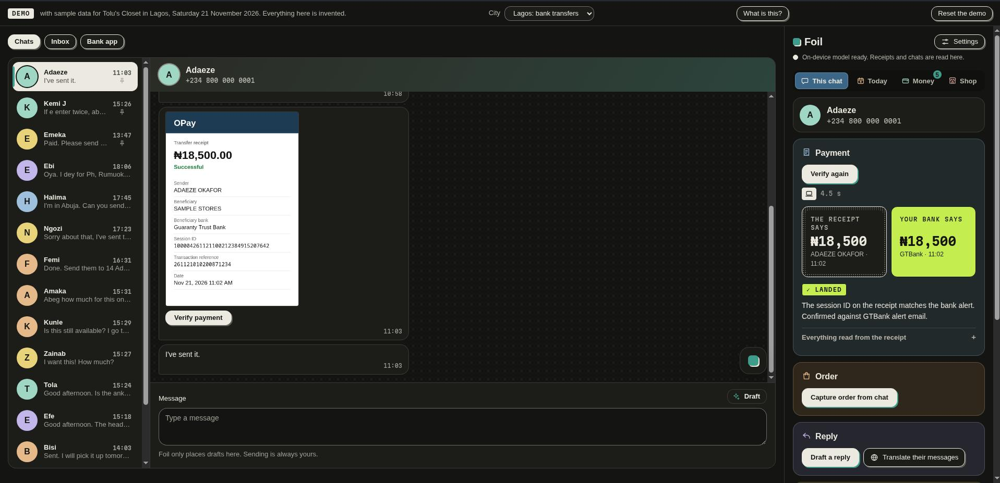
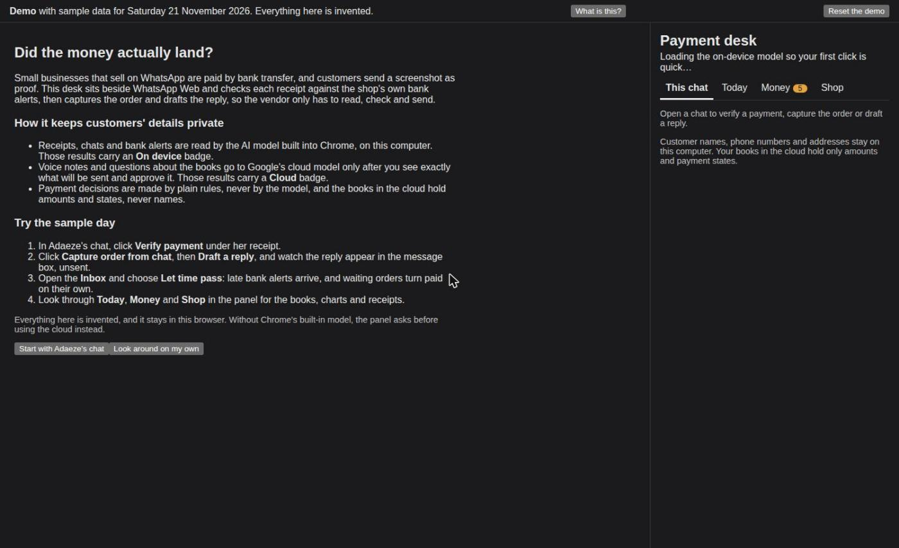
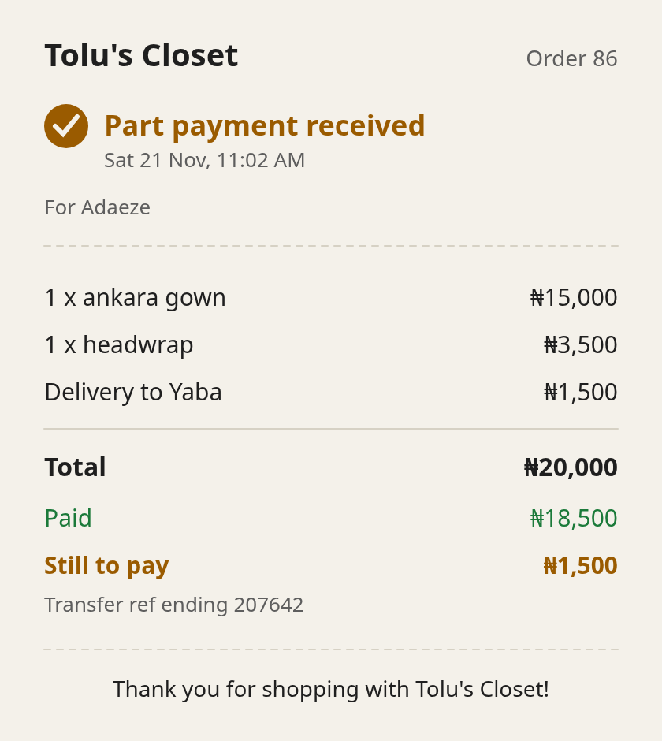
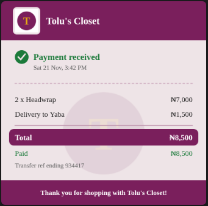
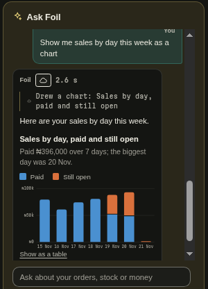
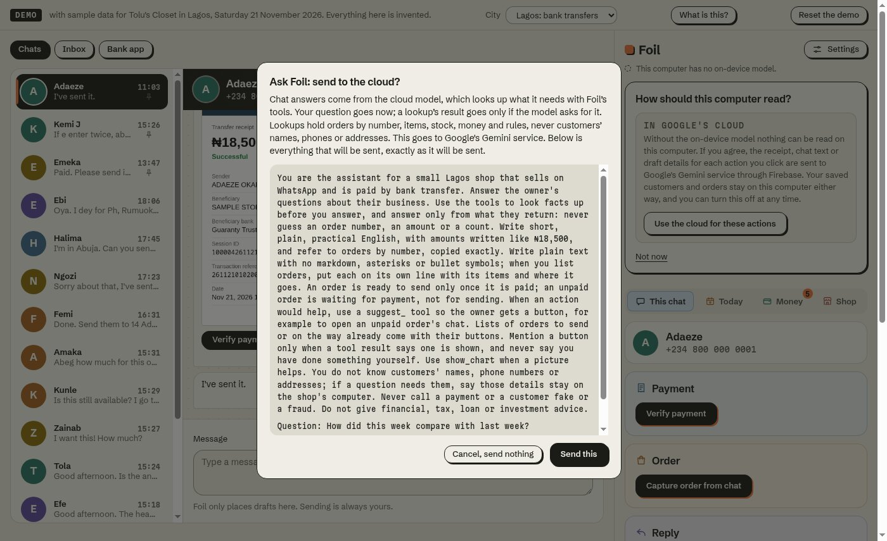
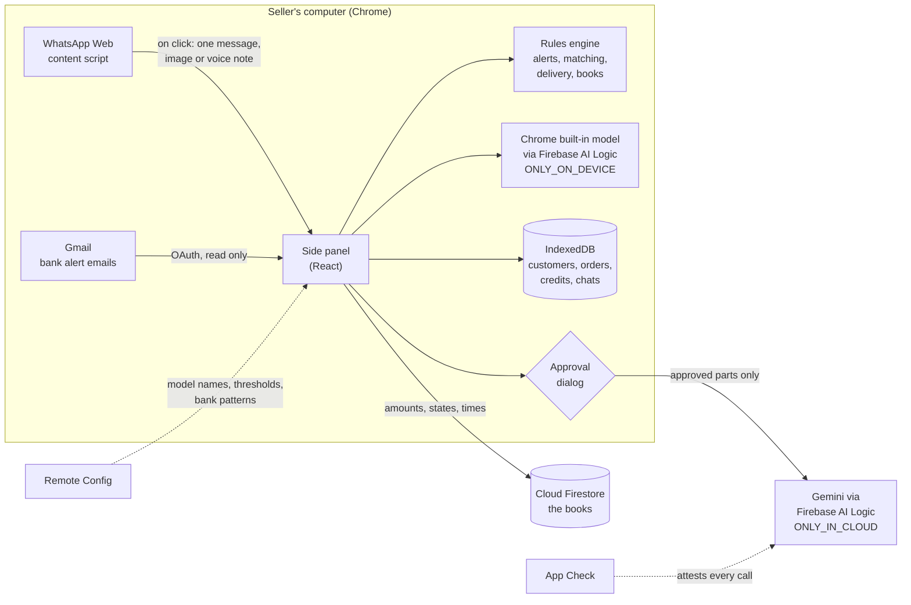
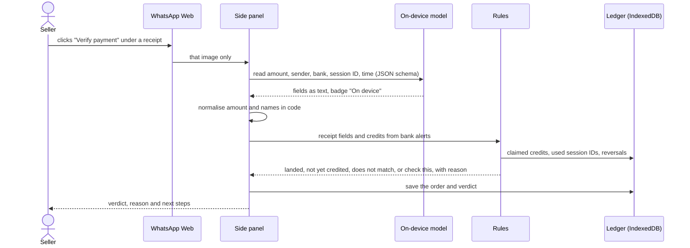

# Foil

**Did the money actually land? Foil is for anyone who sells in chats and gets paid by instant transfer: it checks every payment screenshot against the seller's own bank alerts, with the private reading done by AI on the seller's own computer.**

_Built for #BuildHybridAI 2026, with Firebase AI Logic hybrid inference._

From Lagos to Mumbai to São Paulo, millions of small businesses sell in chat apps and get paid by instant transfer, with a screenshot as the customer's proof. Forged screenshots are a known scam in every one of those markets ([§3](#3-the-problem)). This build starts in Lagos, where it is built and measured end to end for Nigerian bank transfers, and runs the same checks for Mumbai on UPI and São Paulo on Pix, switchable in the demo ([§14](#14-scope-what-foil-does-and-does-not-claim)). Foil sits beside WhatsApp Web as a Chrome side panel. On the seller's click, Chrome's built-in model reads the receipt on the seller's computer; plain rules match it against the seller's own bank alert emails; and Foil captures the order, drafts the reply into the message box (never sending it) and makes a receipt for the customer.

Customers' names, phone numbers, addresses and chats never leave the computer by default. The cloud is used only for jobs the device cannot do (hearing voice notes, holding a conversation about the business, reviewing a week of trading), and each time the seller first sees exactly what will be sent and approves it.

**Why a check against the bank and not a fake detector:** a better forgery always beats an image detector, and a wrong accusation costs the seller a customer. The money arriving in the seller's own account is evidence a forger cannot fake, and every verdict comes with a reason the seller can see.

---

## Status at a glance

|                         |                                                                                                                                                                                                                                                                           |
| ----------------------- | ------------------------------------------------------------------------------------------------------------------------------------------------------------------------------------------------------------------------------------------------------------------------- |
| **Hosted demo**         | Link to follow at release. Sample data, no sign-up, any desktop Chrome ([§2](#2-try-it-in-five-minutes))                                                                                                                                                                  |
| **Demo video**          | Link to follow at release                                                                                                                                                                                                                                                 |
| **Markets**             | Lagos (Nigerian bank transfers, built and measured), Mumbai (UPI) and São Paulo (Pix), each with its own currency, payment-reference rules, banks, reply language and sample day ([§14](#14-scope-what-foil-does-and-does-not-claim))                                     |
| **Chrome extension**    | Manifest V3 side panel for WhatsApp Web and Gmail, a floating Foil button and a writing button on WhatsApp Web itself, built from this repository ([§19](#19-run-it-yourself))                                                                                            |
| **Hybrid surface used** | `ONLY_ON_DEVICE` for the private features, `PREFER_ON_DEVICE` after consent, `ONLY_IN_CLOUD` for audio, other languages, multi-day review and function calling; on the device, tools are chosen through constrained output ([§7](#7-hybrid-inference-feature-by-feature)) |
| **Headline result**     | Receipts read on device in a median **3.4 s**; **every** wrong reading became "check this", never a false match ([§11](#11-measured-not-asserted))                                                                                                                        |
| **Privacy**             | Approval dialog on every cloud call; books in Firestore hold amounts and states only, behind closed-schema rules ([§10](#10-privacy-and-data-flow))                                                                                                                       |
| **Tests**               | 453 unit tests and 7 Firestore-rules emulator tests ([§13](#13-testing))                                                                                                                                                                                                  |
| **Firebase products**   | AI Logic, App Check, Remote Config, Cloud Firestore, Authentication, Hosting ([§12](#12-firebase-products-used))                                                                                                                                                          |
| **Licence**             | [Apache-2.0](LICENSE)                                                                                                                                                                                                                                                     |



_Screenshots show the hosted demo with invented sample data, in its pre-design styling._

## Contents

1. [What this is, in thirty seconds](#1-what-this-is-in-thirty-seconds)
2. [Try it in five minutes](#2-try-it-in-five-minutes)
3. [The problem](#3-the-problem)
4. [The idea: did the money land?](#4-the-idea-did-the-money-land)
5. [Who it is for](#5-who-it-is-for)
6. [What it does](#6-what-it-does)
7. [Hybrid inference, feature by feature](#7-hybrid-inference-feature-by-feature)
8. [Architecture and repository layout](#8-architecture-and-repository-layout)
9. [How a payment is verified](#9-how-a-payment-is-verified)
10. [Privacy and data flow](#10-privacy-and-data-flow)
11. [Measured, not asserted](#11-measured-not-asserted)
12. [Firebase products used](#12-firebase-products-used)
13. [Testing](#13-testing)
14. [Scope: what Foil does and does not claim](#14-scope-what-foil-does-and-does-not-claim)
15. [Limitations](#15-limitations)
16. [Design decisions](#16-design-decisions)
17. [Provenance and originality](#17-provenance-and-originality)
18. [Roadmap and production path](#18-roadmap-and-production-path)
19. [Run it yourself](#19-run-it-yourself)
20. [Hackathon rules compliance](#20-hackathon-rules-compliance)

---

## 1. What this is, in thirty seconds

Adaeze orders an ankara gown and a headwrap on WhatsApp and sends a screenshot of an ₦18,500 transfer. **Today**, the seller opens two banking apps, scrolls for a matching credit, squints at the sender's name, copies the address into a notebook and types a reply, while three other customers wait. If the screenshot was edited, the gown is already on a bike.

**With Foil**, the seller clicks Foil's floating button on WhatsApp Web and picks **Verify the payment**. Four seconds later the panel says **Paid, confirmed against the GTBank alert email**, with an _On device_ badge. One more click captures the order and the delivery fee to Yaba; another drafts the reply into WhatsApp's message box, still unsent. When the money is short, it says so and drafts a polite request for the balance. When a session ID is unreadable, it says _check this_, never _fake_.

The hard part is not reading a receipt. It is deciding, safely, whether a specific credit in a specific bank account belongs to a specific order, across banks with different alert formats, same-bank transfers without session IDs, part payments, reversals and customers who pay twice. **AI reads, rules decide**: the model only extracts text, and tested rules make every decision.

---

## 2. Try it in five minutes

No install, no account and no keys. Everything in the demo is invented and stays in your browser.



| Step | Do this                                                                              | You should see                                                                                                                                                                                                                                               |
| ---- | ------------------------------------------------------------------------------------ | ------------------------------------------------------------------------------------------------------------------------------------------------------------------------------------------------------------------------------------------------------------ |
| 1    | Open the hosted demo in desktop Chrome                                               | A short introduction; the panel on the right shows the on-device model's state                                                                                                                                                                               |
| 2    | Choose **Start with Adaeze's chat**, then click **Verify payment** under her receipt | The receipt beside your bank's alert, a **Landed** verdict with its reason, and an **On device** badge (**Cloud** on a computer without the model) with the seconds it took                                                                                  |
| 3    | Click **Capture order from chat**, **Save order**, then **Draft a reply**            | The order with list prices and the Yaba delivery fee; a reply in WhatsApp's message box asking for the ₦1,500 balance, not sent                                                                                                                              |
| 4    | Open **Inbox** and choose **Let time pass**                                          | Late bank alerts arrive; waiting orders turn paid on their own and appear under **Now paid**                                                                                                                                                                 |
| 5    | In **Ask Foil** at the foot of the panel, choose **What should I restock?**          | With the on-device model, an answer in about 3 seconds with an **On device** badge and nothing sent. Without it, an approval dialog listing exactly what will be sent (no customer names); after **Send this**, an answer with a chart and a **Cloud** badge |
| 6    | Open the **Today** tab, then **Your business over time**, and **Write a review**     | Six charts drawn on the device; a cloud review whose findings each carry one of those charts                                                                                                                                                                 |
| 7    | Back in Adaeze's chat, use **Receipt for the customer**                              | A receipt picture to copy or download, and a text version for the message box; the shop's look is set under **Shop** > **Receipt look**                                                                                                                      |

**Another market?** Choose **Mumbai: UPI** or **São Paulo: Pix** at the top of the demo. Priya's UPI receipt is matched by its 12-digit UPI reference; in São Paulo, Fernanda's receipt says Itaú while its Pix transaction ID carries Nubank's bank code, so it does not match, and replies are drafted in Portuguese through the cloud after approval.

**No built-in model?** Open the demo in a browser without Chrome's model (Brave works): the panel asks before using the cloud, and the badge reads **Cloud**. That is the consent path every feature follows.

**For developers**, the pure logic and the security rules can be checked in about a minute:

```bash
npm install
npm test             # expect: 453 passed, covering matching, parsing, books, tools, writing help, receipts, errors
npm run test:rules   # expect: 7 passed against the Firestore emulator (needs Java)
npm run typecheck && npm run lint   # expect: no output
```

---

## 3. The problem

Small businesses everywhere now sell through chat apps: WhatsApp alone had more than 200 million monthly users of its Business app by mid-2023, the last figure Meta published ([TechCrunch](https://techcrunch.com/2023/06/27/whatsapp-business-crosses-200m-maus-introduces-personlized-messages-feature/)). In much of the world they are paid by instant transfer, with customers sending a screenshot as proof, and forged or recycled screenshots are a documented scam in each of these markets:

| Market      | How chat sellers are paid                                                                                                                                                                                              | What is documented                                                                                                                                                                                                                                                                                        |
| ----------- | ---------------------------------------------------------------------------------------------------------------------------------------------------------------------------------------------------------------------- | --------------------------------------------------------------------------------------------------------------------------------------------------------------------------------------------------------------------------------------------------------------------------------------------------------- |
| Nigeria     | Bank transfer (NIP)                                                                                                                                                                                                    | Of 330 traders surveyed, 52% had fallen victim to fake transactions at least once, and 15% stopped accepting transfers after repeated incidents ([Sahara Reporters, Sep 2026](https://saharareporters.com/2026/09/20/investigation-how-online-platform-slipcraft-helps-scammers-fake-transfers-generate)) |
| India       | UPI: 24.07 billion transactions in September 2026 alone ([NPCI data via StartupTalky](https://startuptalky.com/upi-transactions-september-2026/))                                                                      | Shops hand over goods against fake Google Pay screenshots ([Onmanorama, Sep 2026](https://www.onmanorama.com/news/kerala/2026/09/01/google-pay-scam-jewelry-theft-muvattupuzha.html))                                                                                                                     |
| Brazil      | Pix: 76 billion transactions in 2026 up to October ([Banco Central via Agência Gov](https://agenciagov.ebc.com.br/noticias/202611/pix-celebra-6-anos-como-motor-de-inclusao-e-eficiencia-financeira-em-todo-o-brasil)) | Scammers send a fake Pix receipt ("comprovante falso") to get goods without paying ([Nubank](https://blog.nubank.com.br/comprovante-de-pix-falso-como-identificar-esse-golpe/))                                                                                                                           |
| Kenya       | M-Pesa                                                                                                                                                                                                                 | Fake M-Pesa messages, where victims find no money arrived only after checking their balance ([The Star, Mar 2025](https://www.the-star.co.ke/news/2025-03-27-explainer-what-you-need-to-know-about-m-pesa-fraud-schemes))                                                                                 |
| Philippines | GCash                                                                                                                                                                                                                  | Templates for fake GCash receipts reportedly sold online ([Unbox, Jul 2024](https://unbox.ph/news/fake-gcash-receipts/))                                                                                                                                                                                  |

In every one of these markets the official advice is the same: **check that the money is in your own account, not the screenshot.** Nubank, for example, tells sellers not to hand over the product until they have checked their balance and statement. Sellers do that check by hand, many times a day, alongside everything else:

- **Check the money really arrived**, often across several accounts, while customers wait.
- **Match each payment to the right customer and order**, when several people pay similar amounts within minutes.
- **Copy details out of the chat:** names, phone numbers, addresses, landmarks and items, often in a local language or a mix, sometimes as voice notes.
- **Reply quickly**, before the customer loses patience and buys elsewhere.
- **Close the day knowing** what is paid, what is still open and what is owed back to someone who paid twice.

Sending goods against a screenshot that never turned into money is a direct loss. Holding goods back while checking slowly loses sales. Most sellers cannot use payment links or dedicated accounts for every sale ([§16](#16-design-decisions)), so plain transfers and screenshots remain the norm.

## 4. The idea: did the money land?

Most tools ask **"is this receipt image fake?"**. Foil asks **"did the money land in the seller's account?"**, which is the check every bank and payment app already tells sellers to make. It reads what the receipt claims, then checks it against evidence the forger does not control: the seller's own bank alert emails, or a screenshot of the seller's own banking app.

> **AI reads, rules decide.** The model extracts fields from images and text. Every payment decision is made by plain, testable rules, so each verdict comes with a reason the seller can check.

Around that answer, Foil finishes the job: the order, the delivery fee, the reply, the customer's receipt and the day's books.

## 5. Who it is for

- **Primary user:** a small business that sells in chats (clothes, shoes, accessories, food, thrift) and is paid by instant transfer, often one person with a helper and a rider, working from a laptop with WhatsApp Web and email open.
- **Launch market: Lagos.** This build is made and measured for Lagos sellers paid by bank transfer to banks such as GTBank, OPay, Moniepoint, Kuda and Access, writing in English and Nigerian Pidgin, where power cuts and patchy data are normal. Lagos is a demanding first market: many banks with different alert formats, a documented fake-receipt problem, and sellers who work through outages.
- **Two ways of selling:**
  - **Everyday:** customers chat, ask prices and pay at any time.
  - **Drops:** a timed sale posted to WhatsApp status, often of one-of-a-kind items, where many people reply at once and the first to pay wins.
- **The customer** never sees the tool. They get faster replies in their own register and a clean receipt once their money has landed.
- **Language:** results say _landed_, _not yet credited_ or _does not match_, each with a reason. Foil never calls a customer or a payment fraudulent.

## 6. What it does

The panel has four tabs, **This chat**, **Today**, **Money** and **Shop**, with **Ask Foil** at the foot of every tab and **Settings** at the top. On WhatsApp Web itself, two small controls bring Foil to where the seller works:

- **The floating button:** one draggable Foil button that opens a menu for the open chat: verify the latest payments, capture the order, read the voice note, draft a reply, translate the customer's messages, ask Foil. Picking one opens the side panel and runs it there. It lives in its own shadow root and adds nothing to WhatsApp's own markup.
- **The writing button** on the message box: **Draft** when the box is empty; **Rewrite** once the seller has typed, to make it friendlier, more formal or shorter, fix the spelling, or put it in Pidgin, English, Yoruba, Igbo or Hausa. The same choices appear beside any text the seller selects in the chat, with **What it means in English** for a customer's message. Rewrites run on WhatsApp itself, without opening the panel, through the extension's hidden writer page (an offscreen document) and the same Firebase AI Logic models; a cloud rewrite shows exactly what will be sent, right there, before anything goes.

Each menu item shows where it runs: a laptop for this computer, a cloud for Google's cloud, both when it can run either way.

### In the open chat

| Feature                      | What happens                                                                                                                                                                                                                                                                             |
| ---------------------------- | ---------------------------------------------------------------------------------------------------------------------------------------------------------------------------------------------------------------------------------------------------------------------------------------- |
| **Verify payment**           | From the floating button, or the panel. The model reads the amount, sender, bank, session ID and time on the device; rules match them against the seller's credits and give a verdict with its reason.                                                                                   |
| **Capture order**            | Reads items, quantities (including words like "two of the caps"), name, phone, address, landmark and delivery choice from the chat. Prices come from the shop's stock list, and sold-out items are flagged.                                                                              |
| **Draft a reply**            | Writes in English or Pidgin from the chat, the order, the payment state and the shop's own rules, and places it in the WhatsApp message box. It is never sent; the seller reads, edits and sends.                                                                                        |
| **Read the voice note**      | Once the seller has played it in WhatsApp, and after approval, a voice note is heard in the cloud. It returns order fields, an English summary and the parts that were unclear. A street Foil cannot recognise is marked unclear, and the draft asks the customer to confirm it by name. |
| **Rewrite your reply**       | Rewords what the seller typed, in place, and only if the box still holds exactly that. Every amount and number is checked to survive; a rewrite that drops one is tried again, then flagged. **Put back what I wrote** undoes it.                                                        |
| **Translate their messages** | The customer's messages since the seller last wrote, in plain English. English and Pidgin are handled on the device; other languages in the cloud after approval.                                                                                                                        |
| **Receipt for the customer** | Once paid, a receipt as WhatsApp text or as a picture to copy or download. Part payments show what is still owed.                                                                                                                                                                        |

The receipt picture can carry the shop's own look: its logo (with colours suggested from it), a brand colour that runs through the whole card, a built-in or uploaded font, and an option to show or hide the order number. Text colours are chosen to stay readable on the brand colour; the paid mark always stays green.

<p>
  
  
</p>

### Across the day

- **Who needs you:** customers waiting for a reply, sorted on the device into order, payment, question, complaint and other. Complaints come first.
- **Drop mode:** a customer's status reply quotes the item's photo. Foil matches that thumbnail to the drop item by image comparison in code, then tracks available, held (with a timer), paid and sold, with a waiting line.
- **Money not tied to an order:** double payments and overpayments are recorded as refund owed, refunded or kept, and outgoing refund alerts are matched automatically. Foil records decisions; it never moves money.
- **Books for the day:** totals, part payments, refunds, deliveries and open orders by number.
- **Your business over time:** sales, order hours, time to payment, money by bank and top items over 7, 14 or 30 days, as six charts, with a written review from the cloud.
- **Only what the shop uses:** drop tools appear only for shops that sell in drops, deliveries only for shops that deliver and only when an order is waiting, and the Shop rules ask what the shop sells before anything about riders or parks.
- **Ask Foil, with tools:** Foil has twelve tools, lookups (orders by group, one order, stock, today's money, the week, chats waiting, the drop, refunds owed, shop rules) and actions it can only offer as buttons (mark an order out or delivered, open a chat, send orders to Google Sheets, add a delivery run to Calendar). Every lookup it made shows as a step above the answer. Lists of orders to send come with their buttons, so the seller never depends on the model to offer them.
- **Talk to Foil:** ask by voice, hear the answer, ask again, hands-free, in the answer language chosen in Settings. Chrome recognises the speech on the computer when it can, and reads answers with its own voices, amounts and order numbers said the way people say them.
- **Google Sheets and Calendar:** every order and a total per day to a sheet Foil keeps in the seller's own Drive (it can see only that file), laid out with real dates, currency, a frozen header and a totals row, and an area's delivery run to their calendar at a chosen time. Each send shows exactly what goes first; names go only if ticked, phone numbers and addresses never.
- **Settings:** theme, accent and text size; reply tone and length; the answer language, voice and speed; the matching windows (over Remote Config's recommended values); cloud consent; connections; a download of the seller's records.
- **Ask Foil:** a chat about the whole business ("which orders still need sending?", "what should I restock?", "how did this week compare with last?"). It is sent the shop's own facts, orders by number, items, stock, money and rules, never customers' names, phones or addresses. Answers can carry a chart. When Chrome's model is ready, each question is answered on the device and nothing is sent; **Ask the cloud instead** sends it after approval. Common answers, such as which orders are unpaid or ready to send, are worked out in code first, and order numbers in an on-device answer are checked against the real orders.
- **Offline and power cuts:** records are saved on the device with strict durability, and the cloud books catch up when the connection returns.



## 7. Hybrid inference, feature by feature

Every AI call goes through the **Firebase AI Logic** web SDK. Each feature has its **own model instance with its own inference mode**, chosen for what that feature needs.

| Feature                                  | Inference mode                                            | Why it runs there                                                                                                                                                                                                     |
| ---------------------------------------- | --------------------------------------------------------- | --------------------------------------------------------------------------------------------------------------------------------------------------------------------------------------------------------------------- |
| Read a receipt screenshot                | `ONLY_ON_DEVICE`                                          | Image input; customer and bank details never leave the computer                                                                                                                                                       |
| Read a bank-app history screenshot       | `ONLY_ON_DEVICE`                                          | The seller's own account data                                                                                                                                                                                         |
| Parse an unfamiliar bank alert email     | `ONLY_ON_DEVICE` (known banks use rules, no model)        | The seller's own account data                                                                                                                                                                                         |
| Capture order and delivery details       | `ONLY_ON_DEVICE`                                          | Customer names, phones and addresses                                                                                                                                                                                  |
| Draft a reply in English or Pidgin       | `ONLY_ON_DEVICE`                                          | Built from the customer's chat                                                                                                                                                                                        |
| Draft a reply in Brazilian Portuguese    | `ONLY_IN_CLOUD`, after approval, names swapped out        | Chrome's built-in model documents English, Japanese, Spanish, German and French only                                                                                                                                  |
| Sort the waiting queue                   | `ONLY_ON_DEVICE`                                          | High volume, private, no cost per message                                                                                                                                                                             |
| Any of the above, after explicit consent | `PREFER_ON_DEVICE`                                        | Computers without the model can still use Foil                                                                                                                                                                        |
| Read a voice note                        | `ONLY_IN_CLOUD`, after approval                           | The on-device model does not take audio                                                                                                                                                                               |
| Ask Foil                                 | `ONLY_ON_DEVICE` when the model is ready, in two steps    | Tools are not available on the device on the web, so the model picks one or two through constrained output, code runs them, and the model answers from their results; with no fitting tool, from the whole fact sheet |
| Rewrite a reply, translate a message     | `ONLY_ON_DEVICE` for English and Pidgin                   | The seller's own words and the customer's chat                                                                                                                                                                        |
| Rewrite in Yoruba, Igbo, Hausa or Hindi  | `ONLY_IN_CLOUD`, after approval                           | The on-device model does not write them; names and long numbers are swapped for markers and put back afterwards                                                                                                       |
| Ask Foil, cloud                          | `ONLY_IN_CLOUD` with **function calling**, after approval | Multi-turn chat and tools run only in the cloud on the web. The approval shows, in full, everything a lookup could send; the model's lookups send only parts of it, from the records as approved                      |
| Ask by voice, without on-device speech   | `ONLY_IN_CLOUD`, after approval                           | The recording is shown and approved, then written down; the question waits in the box                                                                                                                                 |
| Review the last 7 to 30 days             | `ONLY_IN_CLOUD`, after approval, totals only              | Reasoning across many days with structured output                                                                                                                                                                     |
| Match a payment                          | Rules, no model                                           | A payment decision must be explainable and repeatable                                                                                                                                                                 |

Each private feature gets two instances: one that can never leave the device, and one used only after the seller consents to the cloud on a computer without the model ([`src/ai/device.ts`](src/ai/device.ts)):

```ts
export function privateModels(options: {
  createOptions: CreateOptions
  onDeviceSchema?: object
  cloudConfig?: GenerationConfig
}): (cloudConsent: boolean) => GenerativeModel {
  // ...
  return (cloudConsent) => {
    if (!cloudConsent) {
      onDevice ??= getGenerativeModel(ai, {
        mode: InferenceMode.ONLY_ON_DEVICE,
        onDeviceParams,
      })
      return onDevice
    }
    consented ??= getGenerativeModel(ai, {
      mode: InferenceMode.PREFER_ON_DEVICE,
      onDeviceParams,
      inCloudParams: { model: appConfig().cloudModel /* ... */ },
    })
    return consented
  }
}
```

Cloud-only jobs never rely on automatic fallback. They use an explicit `ONLY_IN_CLOUD` instance and can only send a request object the seller approved ([`src/cloud/send.ts`](src/cloud/send.ts)):

```ts
// Only the approved object can be sent: its parts are built from it alone.
export function sendApproved(model: GenerativeModel, request: Approved) {
  return timed(() => model.generateContent(partsOf(request)))
}
```

**What makes the split visible on screen:**

- **Source badges.** Every AI result carries a laptop (_on device_) or cloud (_Cloud_) badge with its time, read from the SDK response's `inferenceSource`, never assumed. Ask Foil marks every tool step the same way.
- **The approval dialog.** Before any cloud call, it shows every word and file that will be sent, with names, phone numbers, account numbers and references replaced by neutral labels, and waits for a click. Cancelling sends nothing.
- **Charts the cloud cannot falsify.** In the review and in Ask Foil, the cloud picks _which_ of Foil's charts backs a point, by its id. Every number in a chart is drawn on the device from the seller's own records.
- **Model states.** The panel shows whether Chrome's model is being checked, can be downloaded, is downloading (with progress) or is ready. When it can be downloaded, the seller chooses between the one-time download and the cloud, instead of a first click starting a large download.
- **Constrained output on the device.** On-device calls are constrained to a JSON schema, or to a regular expression for the waiting queue (one letter per message). The model returns strings; code normalises amounts, names, quantities and street names.



## 8. Architecture and repository layout



- **Two hosts, one panel.** The Chrome extension and the hosted demo (simulated chats, inbox and bank app) render the same `Panel` component. Each host supplies how drafts are inserted and what time it is.
- **No custom backend.** Everything runs in the browser against Firebase services.
- **Pure logic is separate.** Matching, parsing, delivery, books, receipts, street checks and error wording are plain TypeScript with no Firebase or browser dependency, and are unit-tested.

| Path              | What it is                                                                          |
| ----------------- | ----------------------------------------------------------------------------------- |
| `src/ai/`         | Firebase AI Logic model instances, one per feature                                  |
| `src/verify/`     | Bank alerts, receipt fields, session IDs, matching rules (pure)                     |
| `src/capture/`    | Orders, delivery, drafts, voice notes, street checks, receipts, brand (pure)        |
| `src/queue/`      | Waiting-queue sorting: batching and the one-letter constraint                       |
| `src/ledger/`     | IndexedDB store, Firestore books sync, day books, trends, charts, business snapshot |
| `src/cloud/`      | Approval step, redaction, cloud-only sender, error wording                          |
| `src/config/`     | Remote Config keys, parsing and in-code defaults                                    |
| `src/extension/`  | Manifest, side panel, WhatsApp Web and Gmail integration                            |
| `src/demo/`       | Hosted demo with simulated panes and its introduction                               |
| `src/sample/`     | Synthetic sample pack and two weeks of synthetic history                            |
| `src/ui/`         | The shared panel, its tabs and cards                                                |
| `firestore.rules` | Closed-schema, owner-only rules for the books                                       |
| `docs/images/`    | Screenshots of the demo, with sample data only                                      |

## 9. How a payment is verified



The matching rules ([`src/verify/match.ts`](src/verify/match.ts)), with thresholds held in Remote Config:

- **Interbank transfers** must carry a consistent NIP session ID: its structure, the sending bank's code, the date and time inside it, and that it has not paid another order. One misread digit is recovered only when exactly one alert is one digit away.
- **An unreadable session ID** leads to _check this_, never to a mismatch, because a misread is not evidence of anything.
- **Same-bank transfers** have no session ID and use a tight time window (10 minutes by default, against 60 for interbank).
- **Names** compare the receipt's sender with the alert's sender (similarity 0.6 by default), never the WhatsApp contact name.
- **One credit pays one order.** When two credits could fit, the seller picks.
- **Only exact known bank sender addresses are trusted** for alert emails. Reversals, pending and failed transfers count as not paid.
- **A later credit can pay a balance.** A short payment stays open with the amount owed, and a second receipt tops it up.

## 10. Privacy and data flow

| Data                                             | Where it lives                                             | Leaves the computer?                                                                                      |
| ------------------------------------------------ | ---------------------------------------------------------- | --------------------------------------------------------------------------------------------------------- |
| Chats, customer names, phones, addresses         | IndexedDB in the browser                                   | Never, unless the seller approves a cloud job that needs part of it                                       |
| Receipt images and bank-app screenshots          | Read in memory, results in IndexedDB                       | Never, unless the seller consents to the cloud on a computer without the model                            |
| Bank alert emails                                | Read from Gmail with read-only OAuth, credits in IndexedDB | Never                                                                                                     |
| Voice notes                                      | Sent to the cloud only after approval                      | Yes, after approval, with the shop's own vocabulary                                                       |
| Ask Foil and the review                          | Sent after approval                                        | Yes: orders by number, items, stock, money, totals and the shop's rules, never names, phones or addresses |
| Books: amounts, payment states, times, order ids | Cloud Firestore                                            | Yes, owner-only, with no names or contact details                                                         |
| Refund decisions: amount, state, times           | Cloud Firestore                                            | Yes, with no customer or account number                                                                   |
| Receipt look: logo, colour, font                 | IndexedDB in the browser                                   | Never                                                                                                     |
| Orders sent to Google Sheets, runs to Calendar   | The seller's own Google account                            | Only when the seller approves each send; names only if ticked, never phones or addresses                  |
| Spoken questions and answers                     | Recognised and spoken by Chrome on the computer            | Never, when Chrome recognises speech on the device; otherwise the recording goes only after approval      |
| The seller's typed reply, for a rewrite          | In memory                                                  | Only for Yoruba, Igbo, Hausa or Hindi, after approval, with names and long numbers swapped out            |

- **WhatsApp Web is read only when the seller clicks**, and only what is already on screen. The extension never sends messages, never clicks WhatsApp's own controls and never crawls chats. The seller plays a voice note themselves before it can be read, and the floating button and writing button change nothing until the seller picks something.
- **Firestore security rules** allow only the signed-in seller to read or write their books, and refuse any field outside a closed list, so a client that tried to add a name or account number would be refused ([`firestore.rules`](firestore.rules), tested against the emulator).
- **Nothing private is logged** to the console, analytics or Firestore.

## 11. Measured, not asserted

Measured on 21 November 2026 on a laptop with an RTX 3060 Mobile, Chrome 157 and the built-in Gemma 4 model, through Firebase AI Logic in `ONLY_ON_DEVICE` mode.

**Method.** A labelled set of invented chats, receipts and bank alerts (8 receipts from different banks and layouts, 10 chats in English and Pidgin) was run through the full pipeline three times: 24 receipt reads and 30 order and draft runs. **The labelled set is synthetic**, so these numbers describe the pipeline on clean inputs, not on every real-world screenshot.

| What                                                   | Result              |
| ------------------------------------------------------ | ------------------- |
| Every on-device call reported on-device inference      | 24/24               |
| Receipt amount, bank and status read on device         | 24/24 each          |
| Receipt sender read on device                          | 23/24               |
| Receipt session IDs read exactly                       | 17/24               |
| Payment verdicts                                       | 22/24               |
| Order totals, items, quantities and pickup             | 30/30 each          |
| Out-of-state deliveries recognised                     | 6/6                 |
| Drafts in the customer's language, with no odd wording | 30/30               |
| Median time on device: receipt, order, draft           | 3.4 s, 3.3 s, 2.0 s |

**Mumbai (UPI) and São Paulo (Pix)**, measured the same way on 22 November 2026 (3 passes over each city's synthetic sample day):

| What                                                         | Mumbai              | São Paulo                |
| ------------------------------------------------------------ | ------------------- | ------------------------ |
| Every call on device                                         | 9/9                 | 12/12                    |
| Receipt amount, sender and status                            | 9/9 each            | 12/12 each               |
| Reference (UPI reference or Pix transaction ID) read exactly | 8/9                 | 10/12                    |
| Payment verdicts                                             | 9/9                 | 11/12                    |
| Order totals, items, quantities and pickup                   | 9/9 each            | 11/12, 12/12, 12/12, 6/6 |
| Replies in English, with no odd wording                      | 9/9                 | cloud by design          |
| Median time on device: receipt, order, reply                 | 3.7 s, 3.6 s, 2.4 s | 3.7 s, 3.4 s, –          |

Measuring the new markets also found and fixed four engine faults:

- a Pix transaction ID glued to the next field;
- Portuguese pickup phrases not recognised;
- two amounts in one field read as one;
- a misread date inside a reference treated as a mismatch.

The one São Paulo verdict miss was a misread Pix transaction ID that became _check this_.

- **Both missed verdicts came out as _check this_**, which hands the decision to the seller. A misread session ID caused each one; neither was a false match or a false mismatch. That is the design working: a misread ID becomes a question, not a wrong answer.
- **The first on-device call** after Chrome starts took 16 seconds while the model loaded. The panel warms the model up in the background, so the seller's first click is usually quick.
- **Cloud calls** took 6 to 12 seconds for voice notes, 1.5 to 3 seconds for the review, and up to about 8 seconds for Ask Foil with a full day's facts. Ask Foil on the device answered in about 3 seconds.
- **Ask Foil on the device** sometimes ran neighbouring order numbers together ("#78, #80" written as "#780"). Common answers are now worked out in code and given to the model, and order numbers in an answer are checked against the shop's real orders.
- **Lessons that shaped the design:**
  - Constraining amounts to a JSON _number_ made the model drop the thousands comma (₦45,000.00 became 450000). Reading amounts as text and parsing them in code fixed it.
  - A voice note heard "Bode Thomas Street" as "Potiskum Street". Street names are now checked in code against well-known streets: near-certain spellings are corrected, close ones are suggested for the seller to confirm, and unknown ones make the draft ask the customer to confirm the street by name.

## 12. Firebase products used

| Product                                      | How it is used                                                                                                                                                                                           |
| -------------------------------------------- | -------------------------------------------------------------------------------------------------------------------------------------------------------------------------------------------------------- |
| **Firebase AI Logic** (Gemini Developer API) | Hybrid on-device and cloud inference, per-feature inference modes, JSON-schema and regex-constrained output on device, structured output, multi-turn chat, function calling and audio input in the cloud |
| **App Check**                                | reCAPTCHA Enterprise on the hosted demo; the extension gets real reCAPTCHA Enterprise tokens through a small bridge page on the hosted domain, which only the extension may embed                        |
| **Remote Config**                            | The cloud model name, matching thresholds, bank details and alert patterns, photo-match thresholds and the Pidgin glossary, with in-code defaults when offline                                           |
| **Cloud Firestore**                          | The seller's books and refund decisions, with an offline cache and closed-schema, owner-only security rules                                                                                              |
| **Authentication**                           | Anonymous sign-in, so the books have an owner without the seller creating an account                                                                                                                     |
| **Hosting**                                  | The demo                                                                                                                                                                                                 |

## 13. Testing

```bash
npm test             # 453 unit tests for all pure logic
npm run test:rules   # 7 Firestore rules tests against the local emulators (needs Java)
npm run typecheck
npm run lint
```

| Suite                      | What it proves                                                                                                                                                                            |
| -------------------------- | ----------------------------------------------------------------------------------------------------------------------------------------------------------------------------------------- |
| Matching                   | Every rule: session-ID structure, bank code, time, reuse and one-digit recovery; same-bank windows; names; one credit per order; reversals; part payments and top-ups                     |
| Parsing                    | Alert emails for each known bank, receipt fields, bank-app history rows                                                                                                                   |
| Capture                    | Order fields and quantity words, delivery planning, drop mode and image matching, voice-note fields and street checks                                                                     |
| Books                      | Day books, trends, chart data, the business snapshot, and that none of them carries a name or phone number                                                                                |
| Receipts and brand         | Receipt contents and text, brand colours, tints and contrast                                                                                                                              |
| Ask Foil tools             | Every tool's output, bad arguments from a model, buttons offered only when Foil itself would, the approval preview holding everything a lookup could send, the on-device router's parsing |
| Writing help               | Rewrite styles per market, numbers surviving a rewrite, markers swapped out and back, which messages read as English                                                                      |
| Sheets, Calendar, voice    | Sheet rows without phones, dates as Sheets counts them, daily totals, calendar events in the shop's time zone, answer languages, spoken wording, voice choice                             |
| Cloud safety               | Redaction of names and numbers, the approved-only sender, plain error wording for every failure                                                                                           |
| Firestore rules (emulator) | Only the owner reads or writes; names, account numbers, wrong types and negative amounts are refused                                                                                      |

The rules tests use a `demo-` project ID that can never reach a real project. On-device accuracy is measured separately ([§11](#11-measured-not-asserted)), because it needs Chrome's model.

## 14. Scope: what Foil does and does not claim

**It does:**

- Tell the seller whether a receipt matches a credit the seller's bank actually reported, and why.
- Keep customers' details on the seller's computer, and show exactly what any cloud call will carry before it goes.
- Record orders, part payments, deliveries, refunds and stock, and keep the books in step.

**It does not:**

- Judge whether an image was edited. A matching credit is the evidence; the picture is only a claim.
- Move money, send messages or automate WhatsApp. Every reply and every refund is the seller's own action.
- Know about money the bank did not report. Without an alert email or a bank-app screenshot for an account, a payment to it shows as _not yet credited_.
- Replace the seller's judgement. _Check this_ means exactly that, and the seller can always pick the credit or undo a decision.

### Why Lagos first, and how it travels

Lagos was chosen as the first market because the problem is acute and documented there, and because doing one market properly (real bank alert formats, real receipt layouts, Pidgin, delivery by area and park) proves more than a shallow version of many. The engine keeps what is market-specific apart from what is not, and Mumbai and São Paulo run on it today:

| Part                           | Lagos                                                               | Mumbai                                                                              | São Paulo                                                            |
| ------------------------------ | ------------------------------------------------------------------- | ----------------------------------------------------------------------------------- | -------------------------------------------------------------------- |
| Payment rail and its reference | NIP session ID: structure, bank code, embedded time, reuse          | UPI reference: 12 digits, reuse (NPCI confirms the length; no date is read from it) | Pix end-to-end ID: sending bank's ISPB, embedded UTC time, reuse     |
| Currency                       | Naira                                                               | Rupees, with Indian digit grouping (₹1,85,000)                                      | Reais, with a decimal comma (R$ 1.234,56)                            |
| Bank alerts                    | Bank-specific parsers, sender addresses checked against real alerts | Common UPI credit wording; unknown formats go to the on-device model                | Common Pix credit wording; unknown formats go to the on-device model |
| Reply language                 | English or Nigerian Pidgin, on device                               | English, on device                                                                  | Brazilian Portuguese, in the cloud after approval                    |
| Receipt status words           | English                                                             | English                                                                             | Portuguese, with a scheduled Pix ("agendado") treated as pending     |
| Sample day in the demo         | A Lagos fashion shop                                                | A Mumbai clothing shop                                                              | A São Paulo boutique                                                 |

What does not change between markets: the "did the money land?" matching, orders, deliveries, stock, books, receipts, Ask Foil, the approval dialog, the privacy rules and the hybrid routing. Pix ISPB codes come from Banco Central's participant list; the Pix transaction ID layout follows Banco Central's identifier scheme and Pix providers' documentation of its UTC timestamp.

## 15. Limitations

- **Synthetic sample days.** All three cities were measured on invented, clean sample days. Alert sender addresses for Indian and Brazilian banks are fictional placeholders until each bank's real address is confirmed.
- **Desktop only.** Chrome on phones always uses the cloud, and many sellers sell from a phone. On-device Android is the natural next platform.
- **Hardware.** The on-device model needs a supported GPU and a one-time download. Computers without it fall back to the cloud only with the seller's consent.
- **Synthetic accuracy set.** The measured numbers are on invented, clean inputs. Real receipts can be cropped, compressed or photographed, and real alert formats vary.
- **Known banks.** Alert parsing by rules covers the banks whose sender addresses and formats are built in; other formats go to the on-device model.
- **Streets.** The street check knows a list of well-known Lagos streets; other streets heard in voice notes are always confirmed with the customer.
- **WhatsApp Web changes.** The content script reads the page as displayed; a WhatsApp Web redesign may need selector updates. It never automates WhatsApp, in line with WhatsApp's terms.
- **Google Sheets and Calendar need the extension.** The Google project is in testing mode, so only its test users can connect; the hosted demo shows exactly what would be sent and sends nothing.
- **Voices and on-device speech depend on the computer.** Chrome usually has English voices; Yoruba, Igbo and Hausa voices often are not installed, and Foil then says so and keeps the answer on screen.
- **Gmail only** for alert emails in this version. Bank SMS alerts are not read.
- **Free-tier cloud.** The cloud features run on the Gemini Developer API free tier, so heavy use can hit rate limits; the error says so plainly, and the device features keep working.
- **The extension's App Check bridge** answers only the extension ID it was set up for, so a copy built from this repository needs its own Firebase project and bridge. Judges are pointed to the hosted demo.

## 16. Design decisions

- **Why not just detect fake receipts?** Image forensics loses to better forgeries and produces confident false accusations. Checking against the seller's own bank evidence answers the question that matters, with a reason the seller can see.
- **Why not Paystack links or virtual accounts?** They settle payment automatically, but cost a fee per payment, need business registration to set up, and many customers still insist on a plain transfer to an account they know. Foil works with the transfers sellers already receive.
- **Why rules for matching, not the model?** A payment decision must be repeatable and explainable. The model is good at reading messy images and text; the rules are good at deciding.
- **Why a side panel beside WhatsApp Web?** Sellers already work there. A separate app would mean exporting chats and copying details, which is exactly the work being removed.
- **Why an approval dialog on every cloud job?** It turns a privacy promise into something the seller can see, every time.
- **Why the cloud for voice, chat and reviews only?** Those are the jobs Chrome's model cannot do on the web (audio, multi-turn chat) or does not need to see private data for (totals). Even Ask Foil answers single questions on the device when it can. Everything that touches a customer's details stays on the device.

## 17. Provenance and originality

- **Built for this hackathon.** The repository starts on 18 November 2026, and all code, the engine, the panel, the demo and the tests were written for this entry. The first idea for the hackathon was a handover desk for online community moderators. On 19 November it was set aside for this one, because fake transfer receipts are a sharper, costlier problem for a specific group of people, and because the receipt itself is the private data on-device AI is best placed to protect. Its feasibility test, which showed the on-device model could sort large batches of messages reliably, became the basis of the waiting queue.
- **Runtime dependencies:** `firebase`, `react`, `react-dom` and `pdfjs-dist` (reading PDF receipts). Charts are drawn as plain SVG, and the receipt picture on a canvas, with no chart or image library.
- **Data.** All sample chats, receipts, alerts, voice-note scripts, history and screenshots are invented. No real customer data is in this repository.
- **Authorship and AI assistance.** The product, its design and its plan are the author's: the problem and audience, the choice to verify against the seller's own bank rather than detect forgeries, the hybrid routing and privacy rules, the matching rules, the feature scope and every trade-off. An AI coding assistant was used to write code to that plan, under review. The author tested every feature on real devices, approved each stage and made every commit.

## 18. Roadmap and production path

- **Bank data without email:** a fintech webhook or open-banking feed behind a small server would replace reading alert emails, keeping the same matching rules.
- **Delivery runs:** grouping the day's approved delivery areas and landmarks into rider runs with Grounding with Google Maps.
- **Android:** the same engine with on-device inference on phones, where most sellers already sell.
- **More markets:** Kenya (M-Pesa) and the Philippines (GCash) next, each with its own wallets, reference rules, currency and reply language; and real, confirmed alert formats for the Indian and Brazilian banks.
- **More languages:** drafts in Yoruba, Igbo, Hausa, Hindi, Portuguese and Swahili, on device where quality allows and through the cloud with approval otherwise.

## 19. Run it yourself

### Turning on Chrome's built-in model

1. Use a recent desktop Chrome on a computer whose GPU the built-in model supports.
2. Open `chrome://flags`, search for the built-in AI (Prompt API) flags, enable them and restart Chrome.
3. Open `chrome://on-device-internals` to see whether the model is downloaded and ready.
4. In the panel, if the model can be downloaded, choose **Download the on-device model** once. Afterwards the private features work offline.

Without the model, the panel offers the cloud instead, after a consent screen that says what will be sent; the choice can be turned off at any time. On laptops with two GPUs, Chrome may need to run on the dedicated GPU for the model to report as available.

### The web app

You need Node 20 or later, desktop Chrome, and your own Firebase project with AI Logic (Gemini Developer API), App Check (reCAPTCHA Enterprise), Cloud Firestore, Remote Config and Anonymous Authentication enabled.

```bash
git clone https://github.com/Samuel-Chuku/foil.git
cd foil
npm install
cp .env.example .env.local   # then fill in your Firebase web config and reCAPTCHA site key
npm run dev                  # open the printed URL in desktop Chrome
```

1. For local development, the App Check SDK prints a **debug token** in the browser console on first run. Register it in the Firebase console under App Check > Apps > Manage debug tokens, and put it in `.env.local` as `VITE_APPCHECK_DEBUG_TOKEN`. Production builds never include it.
2. Deploy the security rules: `npx firebase login`, then `npx firebase deploy --only firestore:rules`.
3. Optional: set the Remote Config parameters listed in [`src/config/parse.ts`](src/config/parse.ts) to change the cloud model, thresholds or bank details without a release.

### The Chrome extension

**Judges: please use the hosted demo.** The extension gets real App Check tokens from a bridge page on the hosted domain, and that page answers only the extension ID it was set up for. A build from this repository needs your own Firebase project, set up as above.

```bash
npm run build:extension
```

1. Open `chrome://extensions`, turn on **Developer mode**, choose **Load unpacked** and select the `dist-extension` folder.
2. Open WhatsApp Web, then the extension's side panel. A short **Getting started** card explains the first steps.
3. For real App Check tokens, deploy the hosted app, put your extension's ID in `src/bridge/protocol.ts` and in the `/appcheck.html` header in `firebase.json`, and set `VITE_APPCHECK_BRIDGE_URL` to your `https://<project>.web.app/appcheck.html` before building. Without it, the extension uses your debug token.
4. For bank alerts from Gmail, create a "Web application" OAuth client whose redirect URI is `https://<extension id>.chromiumapp.org/`, and set `VITE_GMAIL_WEB_CLIENT_ID` before building.

### Troubleshooting

| Symptom                                       | What to do                                                                                                                |
| --------------------------------------------- | ------------------------------------------------------------------------------------------------------------------------- |
| "This computer has no on-device model"        | Check `chrome://on-device-internals`; on two-GPU laptops run Chrome on the dedicated GPU; or allow the cloud in the panel |
| "The cloud refused this app"                  | The App Check debug token is missing or not registered, or the bridge page does not list your extension's ID              |
| "The free cloud allowance is used up for now" | The Gemini free tier hit its limit; wait a minute. On-device features and the rules keep working                          |
| The books say "the books refused the update"  | Deploy the current `firestore.rules`                                                                                      |

## 20. Hackathon rules compliance

| Rule                                                | How this project meets it                                                                                                                                                                                                                                                                                                                                                        |
| --------------------------------------------------- | -------------------------------------------------------------------------------------------------------------------------------------------------------------------------------------------------------------------------------------------------------------------------------------------------------------------------------------------------------------------------------- |
| Every AI call goes through Firebase AI Logic        | All model calls use the Firebase AI Logic web SDK. Chrome's `LanguageModel.availability()` is called directly only to show the model's state, never for inference. Speech is turned into text, and answers into speech, by Chrome's Web Speech features on the computer (`processLocally`); every question, answer, draft and rewrite is still written through Firebase AI Logic |
| Firebase AI Logic is imported and called at runtime | Every feature in [§7](#7-hybrid-inference-feature-by-feature) calls it on the seller's click                                                                                                                                                                                                                                                                                     |
| App Check is enabled                                | reCAPTCHA Enterprise on the hosted demo and, through a bridge page, in the extension; debug tokens are for local development, kept in `.env.local`, never committed                                                                                                                                                                                                              |
| No secrets or personal data in the repo             | `.env.example` holds empty values; sample data, screenshots and tests are invented                                                                                                                                                                                                                                                                                               |
| Open-source licence                                 | Apache-2.0, at the repository root                                                                                                                                                                                                                                                                                                                                               |
| Free to use, in English                             | The demo needs no account and costs nothing to use                                                                                                                                                                                                                                                                                                                               |

## Licence

Apache-2.0. See [LICENSE](LICENSE).
